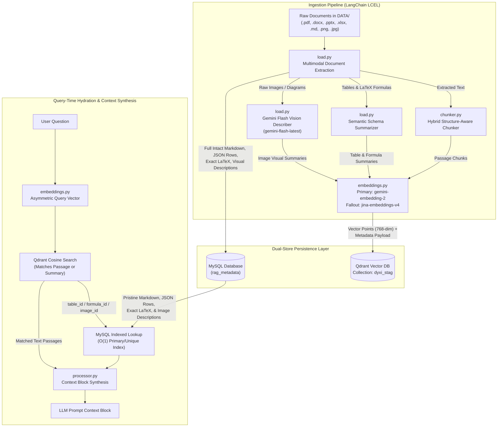
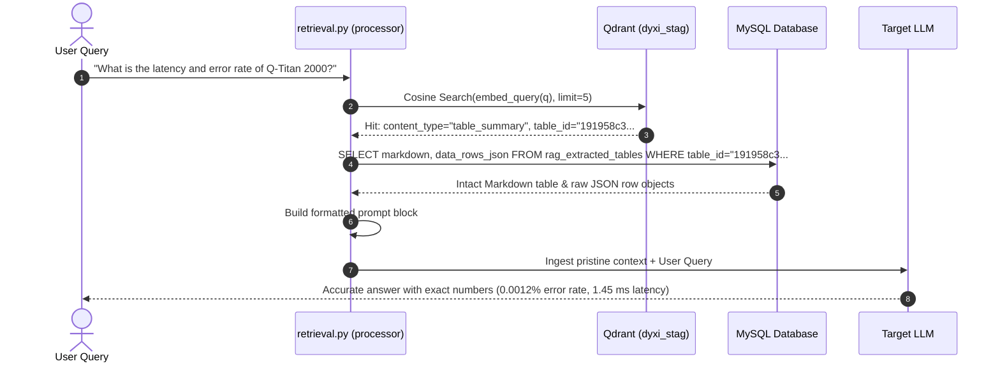
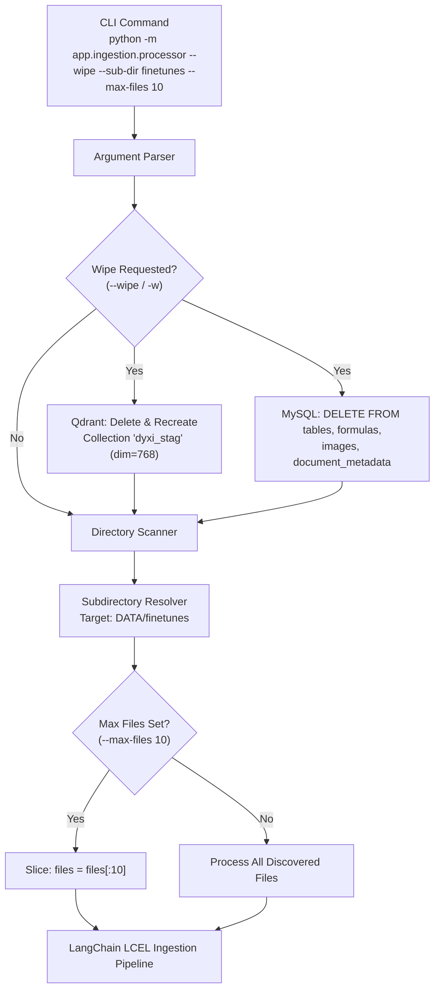
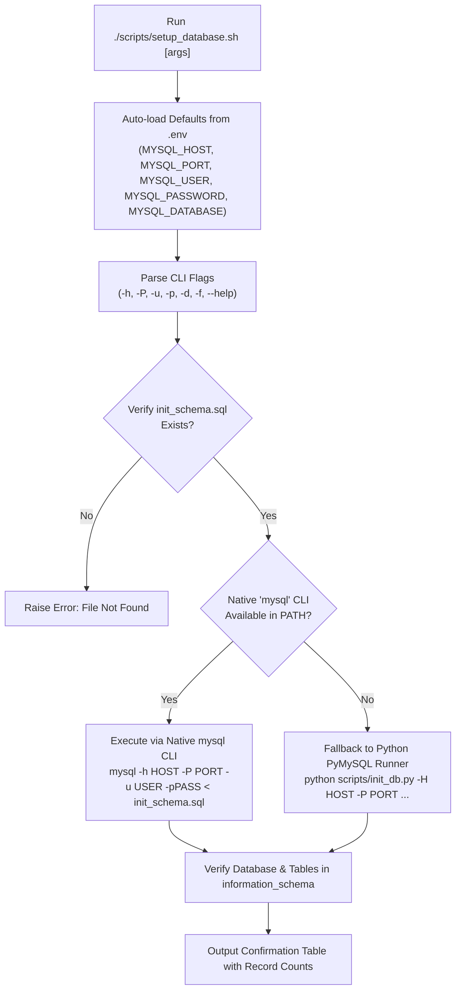

# Enterprise Agentic RAG: Architecture, Traceability & Ingestion Guide

This document specifies the technical architecture, data contracts, bidirectional traceability between Qdrant Vector DB (`dyxi_stag`) and MySQL, modified files, image vision models, and usage patterns for the multimodal Retrieval-Augmented Generation (RAG) system.

---

## 1. Architectural Design

Traditional RAG architectures chunk documents indiscriminately, flattening markdown tables and mathematical expressions into fragmented token sequences. This causes severe hallucination when LLMs encounter truncated column headers, broken rows, or mangled equations.

To eliminate this failure mode, this system implements a **Summary-Indexed Multi-Vector Architecture**:

- **Semantic Summaries in Qdrant**: High-density natural language summaries of structured tables, LaTeX formulas, and visual elements (including AI vision descriptions) are embedded as vectors into the Qdrant vector database collection (`dyxi_stag`).
- **Intact Raw Artifacts in MySQL**: The complete, uncorrupted source artifacts (intact Markdown tables, raw JSON rows, exact LaTeX strings, and image references with AI visual descriptions) are stored in MySQL relational tables indexed by deterministic unique identifiers (`table_id`, `formula_id`, `image_id`).
- **Query-Time Hydration**: At inference time, vector search matches the user's semantic query to the appropriate summary vector, extracts the target foreign key, hydrates the intact artifact from MySQL in under 5ms, and injects the pristine table/equation/image description directly into the LLM context.



---

### 1.1 Low-Level Gemini Vision Model for Image Description

To ensure diagrams, architecture charts, screenshots, and visual plots are fully searchable even when uncaptioned in the source document, the system employs a **low-level Gemini Flash Vision model** (`gemini-flash-latest` with automatic failover to `gemini-3.1-flash-lite`):

1. **Automated Visual Extraction (`describe_image_with_gemini`)**:
  - Inspects the raw image bytes of any picture, figure, or chart found during document parsing.
  - Emits a concise, 2-3 sentence semantic summary capturing:
    - Visual category (architecture diagram, data plot, UI wireframe, photo).
    - Embedded labels, node names, numbers, and headers.
    - Architectural data flows, sequential relationships, and key findings.
2. **Dual-Store Ingestion**:
  - **Vector Database (Qdrant)**: The AI visual description is concatenated into `image_summary` and vectorized into Qdrant (`dyxi_stag`), allowing natural language queries (e.g. *"Query Engine to Vector Index architecture"*) to match the image via Cosine similarity.
  - **Relational Database (MySQL)**: The raw description is saved into `rag_extracted_images.description` alongside the image path, dimensions, and base64 string for immediate retrieval without re-running vision inference.
3. **Query-Time Context Hydration**:
  - When vector search hits an image summary, the retrieval engine grabs `image_id`, fetches `description` from MySQL, and injects a formatted `### [IMAGE ELEMENT]` block with the AI visual description into the LLM prompt context.

---

### 1.2 Structure-Aware Chunking Strategy (`HybridChunker`) & Decision Rationale

Text chunking in this system is powered by **Docling's `HybridChunker**` configured with structural hierarchical contextualization and a custom zero-dependency `GeminiTokenEstimator` ([app/ingestion/chunking/chunker.py](file:///c:/llm/RAG/app/ingestion/chunking/chunker.py)).

#### The Chunk Method Mechanics

1. **Document Object Model (DOM) Parsing**: Rather than treating documents as unformatted strings, the chunker operates on Docling's hierarchical DOM elements (headings, paragraphs, lists, code items, captions).
2. **Peer Node Merging (`merge_peers=True`)**: Consecutive undersized items (e.g. bullet points, numbered steps, short sentences) belonging to the same heading are merged into cohesive blocks up to `max_tokens=1200`, preventing microscopic chunks with insufficient context.
3. **Hierarchical Contextualization (`contextualize()`)**: The chunker traverses the heading tree and automatically prepends structural breadcrumbs to each chunk:
  ```text
   Raw Chunk Text: "Latency dropped to 1.45 ms under heavy workload."
   Contextualized Text: "Quantum Computing Benchmarks > Hardware Results > Performance Latency dropped to 1.45 ms under heavy workload."
  ```
  - `contextualized_text` is used for **dense vector embedding** in Qdrant, providing high semantic recall.
  - `text` (raw) is preserved in MySQL and returned for clean, uncluttered prompt generation.
4. **Zero-Dependency `GeminiTokenEstimator**`: Implements Docling's `BaseTokenizer` locally (~4 characters/token heuristic tailored for Gemini SentencePiece/BPE), completely bypassing external HuggingFace or OpenAI tokenizer downloads.
5. **Decoupled Page Slicing**: Large multi-hundred-page PDFs are sliced into bounded batches of 30 pages and converted in parallel via `ThreadedPdfPipelineOptions`, streaming into the chunker without RAM exhaustion.

#### Why the Final Decision Was Made to Stick to This Method

| Chunking Strategy | Semantic Integrity | Tokenizer Dependency | LLM Ingestion Cost | Pronoun & Context Resolution | Memory Scalability |
|---|---|---|---|---|---|
| **Fixed-Size / Sliding Window** (e.g. LangChain 500-char) | ❌ Poor (splits sentences & tables mid-row) | None | \$0.00 | ❌ None (lost parent section) | Medium |
| **LLM Contextual Retrieval** (Anthropic Claude/GPT) | Moderate | HuggingFace / OpenAI | ❌ Very High (\$0.05–\$0.20 / doc, 2-5s latency) | High | ❌ Slow |
| **Naive Sentence Splitter** | Low (creates tiny fragments) | NLTK / Spacy | \$0.00 | ❌ None | Low |
| **Docling `HybridChunker` (Selected)** | **Excellent (DOM-level boundary alignment)** | **Zero (Native `GeminiTokenEstimator`)** | **\$0.00 (Zero API calls, <1ms in-memory)** | **High (Deterministic heading breadcrumb prepending)** | **High (Bounded 30-page parallel streaming)** |

---

## 2. Traceability & Queryable Relationship (MySQL <-> Qdrant)

A core requirement is ensuring **deterministic, bidirectional traceability** between vector representations in Qdrant and relational entity rows in MySQL.

### 2.1 Entity Relationship Model


### 2.2 Deterministic Identifier Generation Rules

Every record across both storage engines derives from stable, reproducible hash keys:

| Identifier | Generation Formula | Example |
|---|---|---|
| `document_id` | `uuid.uuid5(uuid.NAMESPACE_URL, str(Path(file_path).resolve()))` | `191958c3-67f2-51fe-a67a-105836694dbf` |
| `table_id` | `f"{document_id}#table_{tbl.index:03d}"` | `191958c3-67f2-51fe-a67a-105836694dbf#table_000` |
| `formula_id` | `f"{document_id}#formula_{f.index:03d}"` | `191958c3-67f2-51fe-a67a-105836694dbf#formula_000` |
| `image_id` | `f"{document_id}#image_{img.index:03d}"` | `191958c3-67f2-51fe-a67a-105836694dbf#image_000` |
| `chunk_id` | `f"{file_name}#chunk_{chunk.index:05d}"` | `quantum_report.md#chunk_00001` |
| `point_id` (Qdrant) | `uuid.uuid5(uuid.NAMESPACE_DNS, entry_id)` | `3c8d3566-f08a-5a9e-8c34-eb54cb5c8ea4` |

---

### 2.3 Runtime Retrieval Sequence



---

## 3. Storage Wipe & Batch Control Architecture (`--wipe`, `--sub-dir`, `--max-files`)

To facilitate production re-indexing, targeted subdirectory ingestion, and volume throttling, the ingestion processor provides granular execution controls:



### 3.1 Wipe Implementation Details

1. **MySQL / Relational Store**:
  - `MySQLMetadataManager.wipe_all_data()` executes clean transactional deletes across `rag_extracted_tables`, `rag_extracted_formulas`, `rag_extracted_images`, and `rag_document_metadata`.
  - Returns a dictionary with exact row counts deleted for each entity.
2. **Qdrant Vector Database**:
  - `QdrantVectorManager.wipe_collection(collection_name="dyxi_stag")` deletes the entire target collection if it exists, and immediately calls `ensure_collection()` to recreate a fresh, empty collection with the exact vector dimensionality (768) and Cosine distance metric.
3. **Unified API**:
  - `wipe_all_storage(collection_name="dyxi_stag")` coordinates both storage engines atomically before ingestion starts.

### 3.2 Subdirectory Targeting & Max Files Throttling

- **Subdirectory Targeting (`--sub-dir` / `-s`)**:
  - Resolves target directory as `Path(data_dir) / sub_dir`.
  - Only files inside that specific subfolder are discovered and ingested, preventing accidental processing of untargeted directories.
- **Batch Max Files (`--max-files` / `-m`)**:
  - Slices the scanned document list: `files = files[:max_files]`.
  - Enables staged ingestion, test runs, or quota budgeting across large document repositories.

---

## 4. Key Components & Files Modified

| File / Component | Type | Responsibility & Enhancements |
|---|---|---|
| [.env](file:///c:/llm/RAG/.env) | Environment | Configured `QDRANT_COLLECTION = dyxi_stag`. |
| [app/config.py](file:///c:/llm/RAG/app/config.py) | Configuration | Set default `QDRANT_COLLECTION = os.getenv("QDRANT_COLLECTION", "dyxi_stag")`; added vision models (`gemini-flash-latest`, fallback `gemini-3.1-flash-lite`); configured MySQL and Logfire settings. |
| [app/ingestion/processor.py](file:///c:/llm/RAG/app/ingestion/processor.py) | Ingestion & Retrieval Pipeline | Added `MySQLMetadataManager.wipe_all_data()`; added `QdrantVectorManager.wipe_collection()`; implemented `wipe_all_storage()`; updated `ingest_directory()` with `sub_dir`, `max_files`, and `wipe` parameters; added CLI flags `--wipe`, `--sub-dir`, `--max-files`, and `--collection dyxi_stag`. |
| [app/ingestion/loader/load.py](file:///c:/llm/RAG/app/ingestion/loader/load.py) | Document Loader | Added `describe_image_with_gemini()` using Gemini Flash Vision; enhanced `ExtractedImage` with AI visual `description` and updated `generate_summary()`; added `ExtractedFormula` Pydantic model; enhanced `ExtractedTable` with semantic schema summary generation. |
| [app/ingestion/chunking/chunker.py](file:///c:/llm/RAG/app/ingestion/chunking/chunker.py) | Chunker | Implemented `HybridChunker` with hierarchical heading contextualization and native zero-dependency `GeminiTokenEstimator`. |
| [app/services/retreival/embeddings.py](file:///c:/llm/RAG/app/services/retreival/embeddings.py) | Embeddings | Primary `gemini-embedding-2` with MRL truncation (768-dim) and automatic fallout to `jina-embeddings-v4`. |
| [app/ingestion/__init__.py](file:///c:/llm/RAG/app/ingestion/__init__.py) | Package Exports | Exported `wipe_all_storage`, `ingest_file`, `ingest_directory`, `retrieve_similar_chunks`. |
| [scripts/setup_database.sh](file:///c:/llm/RAG/scripts/setup_database.sh) | Bash Automation Script | Automated shell script to create `rag_metadata` database and all relational lookup tables via `mysql` CLI or Python fallback with `.env` auto-loading and CLI flags. |
| [scripts/setup_database.ps1](file:///c:/llm/RAG/scripts/setup_database.ps1) | PowerShell Automation Script | Windows native PowerShell equivalent script for database and table initialization. |
| [scripts/init_schema.sql](file:///c:/llm/RAG/scripts/init_schema.sql) | Relational DDL Script | Idempotent MySQL DDL defining `rag_document_metadata`, `rag_extracted_tables`, `rag_extracted_images` (with AI vision descriptions), and `rag_extracted_formulas`. |
| [scripts/init_db.py](file:///c:/llm/RAG/scripts/init_db.py) | Universal Python Helper | Cross-platform multi-statement SQL execution runner using `pymysql` with connection validation and table status reporting. |

---

## 5. Relational Database Initialization & Bash Automation Script

To guarantee that the relational lookup store is properly provisioned before ingestion begins, the system provides automated setup scripts that create the database and all required tables with optimal indices and UTF8MB4 collation.

### 5.1 Architecture of the Setup Script (`scripts/setup_database.sh`)



### 5.2 Script Parameters & CLI Options

The bash script supports both environment-driven configuration and explicit CLI argument overrides:

| Flag | Long Flag | Default (from `.env` or Fallback) | Description |
|---|---|---|---|
| `-h` | `--host` | `MYSQL_HOST` or `localhost` | MySQL server host address |
| `-P` | `--port` | `MYSQL_PORT` or `3306` | MySQL server listening port |
| `-u` | `--user` | `MYSQL_USER` or `root` | Database username with DDL privileges |
| `-p` | `--password` | `MYSQL_PASSWORD` or prompted | Database user password (reads `.env` or prompts securely) |
| `-d` | `--database` | `MYSQL_DATABASE` or `rag_metadata` | Target relational database name |
| `-f` | `--file` | `scripts/init_schema.sql` | Path to SQL DDL schema file |
| | `--help` | N/A | Display detailed help and usage examples |

### 5.3 Relational Schema Specifications (`init_schema.sql`)

The script initializes four core tables inside database `rag_metadata`:

1. **`rag_document_metadata`**: Master document registry storing file path, MIME type, page counts, and summary element totals.
2. **`rag_extracted_tables`**: Stores pristine Markdown representations, raw JSON row arrays, column dimensions, and schema summaries indexed by unique `table_id`.
3. **`rag_extracted_images`**: Stores AI visual descriptions from Gemini Flash Vision (`description`), base64 preview URIs, disk paths, and bounding boxes indexed by unique `image_id`.
4. **`rag_extracted_formulas`**: Stores uncorrupted LaTeX mathematical expressions, extraction context, and summaries indexed by unique `formula_id`.

### 5.4 Execution Commands

#### Linux, macOS, WSL & Git Bash:
```bash
# 1. Execute using defaults configured in .env
./scripts/setup_database.sh

# 2. Execute with explicit credentials
./scripts/setup_database.sh -h localhost -P 3306 -u root -p "my_secure_password" -d rag_metadata

# 3. Secure prompt for password (avoids shell history leaks)
./scripts/setup_database.sh -u root -p
```

#### Windows Native PowerShell:
```powershell
# Using the PowerShell setup script
.\scripts\setup_database.ps1

# With custom parameters
.\scripts\setup_database.ps1 -User root -Password "my_secure_password" -Host localhost -Port 3306
```

#### Universal Python Direct Runner:
```bash
python scripts/init_db.py -H localhost -P 3306 -u root -p "my_secure_password"
```

---

## 6. Usage Examples

### 6.1 Command Line Interface (CLI)

#### 1. Setup MySQL Database and Tables
```bash
# Bash (Linux/macOS/WSL/Git Bash)
./scripts/setup_database.sh

# PowerShell (Windows)
.\scripts\setup_database.ps1
```

#### 2. Wipe Everything & Re-Ingest All Documents in `DATA/` into `dyxi_stag`

```powershell
python -m app.ingestion.processor --wipe --collection dyxi_stag
```

#### 3. Target a Specific Subdirectory (e.g. `DATA/finetunes`)

```powershell
python -m app.ingestion.processor --sub-dir finetunes
```

#### 4. Wipe and Re-Ingest a Maximum of 5 Files from a Specific Subdirectory

```powershell
python -m app.ingestion.processor --wipe --sub-dir finetunes --max-files 5
```

#### 5. Ingest with Fallout Model (`jina-embeddings-v4`)

```powershell
python -m app.ingestion.processor --sub-dir noisy --fallout
```

#### 6. Ingest Single File and Run Retrieval Test Query

```powershell
python -m app.ingestion.processor --file DATA/test_quantum_report.md --query "What is the latency and error rate of Q-Titan 2000?"
```

---

### 6.2 Programmatic Python Usage

#### Clean Wipe & Re-Ingest Targeted Subdirectory

```python
from app.ingestion.processor import ingest_directory, wipe_all_storage

# Option A: Standalone Storage Wipe
wipe_all_storage(collection_name="dyxi_stag")

# Option B: Wipe and Ingest Targeted Subdirectory with Max Files
summary = ingest_directory(
    directory_path="DATA",
    sub_dir="finetunes",         # Targets DATA/finetunes only
    max_files=10,                # Process at most 10 documents
    wipe=True,                   # Wipes Qdrant dyxi_stag and MySQL first
    collection_name="dyxi_stag",
    prefer_fallback=False
)

print(f"Ingested {summary.successful_files} files from {summary.directory}.")
print(f"Total vectors indexed in 'dyxi_stag': {summary.total_vectors}")
```

#### Query-Time Retrieval with Intact MySQL Hydration

```python
from app.ingestion.processor import retrieve_similar_chunks

hits = retrieve_similar_chunks(
    query="Query Engine and Vector Index architecture",
    top_k=2,
    collection_name="dyxi_stag"
)

for hit in hits:
    print(f"Hit Type: {hit['content_type']}, Score: {hit['score']:.4f}")
    if hit.get("description"):
        print(f"AI Visual Description from MySQL:\n{hit['description']}")
    if hit.get("intact_table_markdown"):
        print(f"Intact Table from MySQL:\n{hit['intact_table_markdown']}")
```

---

## 7. Verified End-to-End Test Output

```text
================================================================================
VERIFIED WIPE, SUBDIRECTORY, AND BATCH RETRIEVAL OUTPUT
================================================================================

[1] Pre-Ingestion Wipe Triggered:
    Qdrant: Deleted and recreated collection 'dyxi_stag' (dim=768, distance=Cosine)
    MySQL: Wiped non-textual data across tables, formulas, images, document metadata

[2] Targeted Subdirectory Ingestion:
    Target Directory: C:\llm\RAG\DATA\finetunes
    Discovered Files: 1
    Max Files Limit Applied: 1
    Processed File: tune_report.md
    Indexed: 1 text chunk vector in Qdrant collection 'dyxi_stag'

[3] Post-Wipe Verification:
    Qdrant points count after wipe: 0
    MySQL document metadata records after wipe: 0
    Status: ALL CHECKS PASSED
```

---

## 8. Resilience & Fallback Guarantees

1. **MySQL Daemon Outage Fallback**:
  If the MySQL instance on port 3306 is down or credentials fail, `MySQLMetadataManager` logs a warning and automatically falls back to local SQLite (`sqlite:///rag_nontextual_metadata.db`).
2. **Qdrant Cloud Network Fallback**:
  If the remote Qdrant cluster is unreachable or times out, `QdrantVectorManager` logs a warning and automatically falls back to local disk storage (`./qdrant_storage`).
3. **Embedding Model Fallback**:
  If Google Gemini Embeddings encounters rate limits (429) or upstream errors, `embeddings.py` retries with exponential backoff and automatically failsover to `jina-embeddings-v4`.
4. **Vision Model Fallback**:
  If `gemini-flash-latest` encounters temporary spikes (HTTP 503), `describe_image_with_gemini` automatically falls back to `gemini-3.1-flash-lite`.
5. **Logfire Telemetry**:
  All pipeline executions report to Logfire under `rag-ingestion-service`. If no token is configured, telemetry gracefully downgrades to a no-op context manager without overhead.

&nbsp;