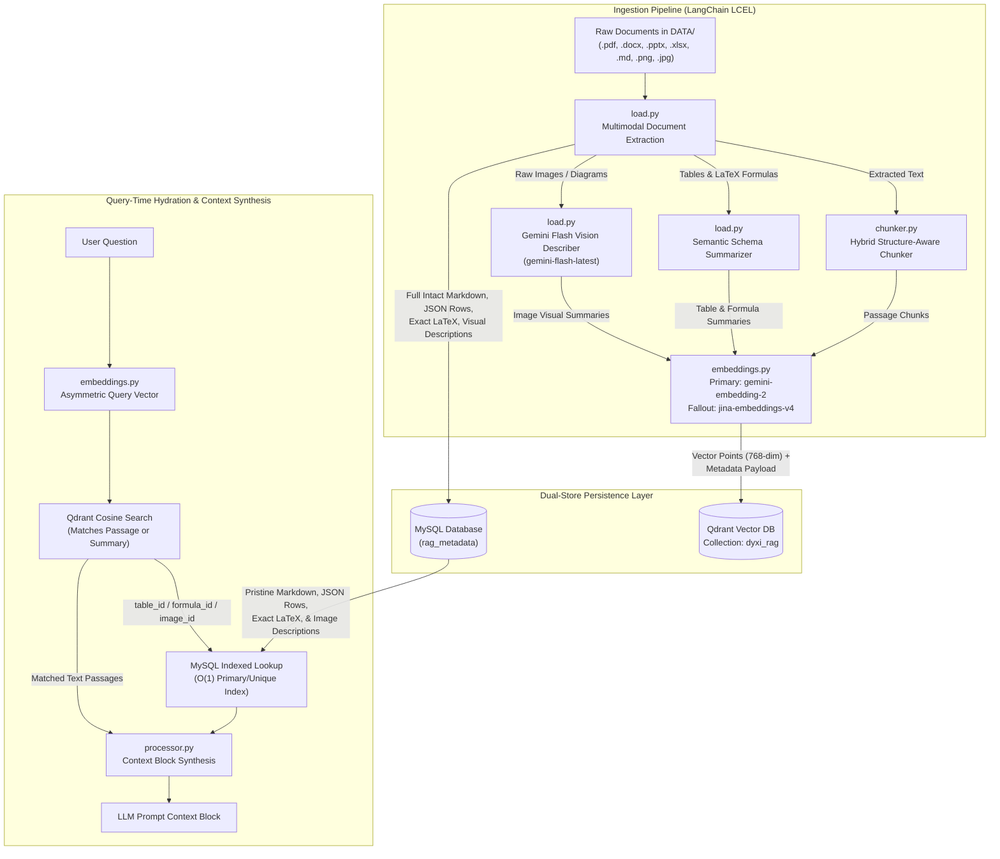
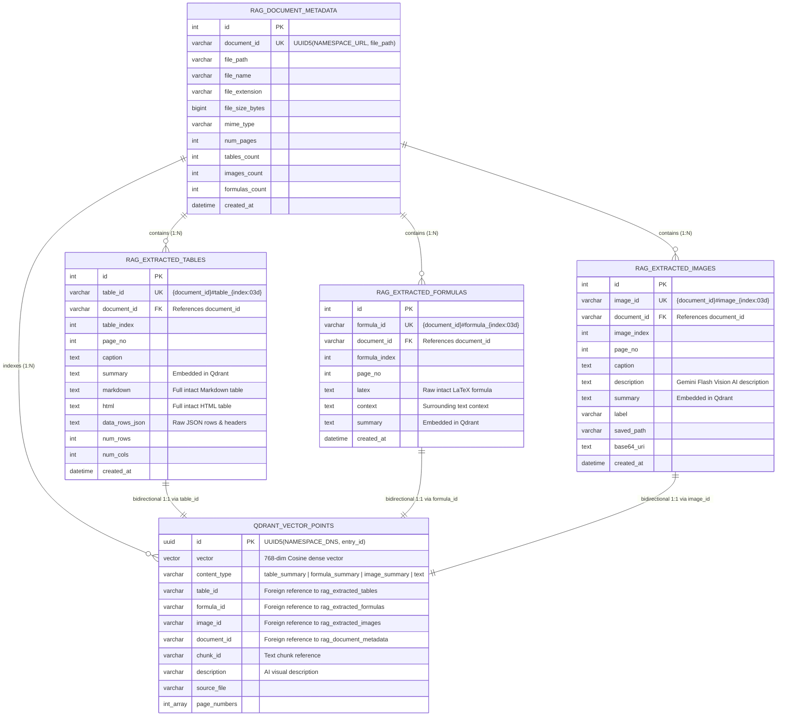

# Enterprise Agentic RAG: Architecture, Traceability & Ingestion Guide

This document specifies the technical architecture, data contracts, bidirectional traceability between Qdrant Vector DB and MySQL, modified files, image vision models, and usage patterns for the multimodal Retrieval-Augmented Generation (RAG) system.

---

## 1. Architectural Design

Traditional RAG architectures chunk documents indiscriminately, flattening markdown tables and mathematical expressions into fragmented token sequences. This causes severe hallucination when LLMs encounter truncated column headers, broken rows, or mangled equations.

To eliminate this failure mode, this system implements a **Summary-Indexed Multi-Vector Architecture**:
- **Semantic Summaries in Qdrant**: High-density natural language summaries of structured tables, LaTeX formulas, and visual elements (including AI vision descriptions) are embedded as vectors into the Qdrant vector database.
- **Intact Raw Artifacts in MySQL**: The complete, uncorrupted source artifacts (intact Markdown tables, raw JSON rows, exact LaTeX strings, and image references with AI visual descriptions) are stored in MySQL relational tables indexed by deterministic unique identifiers (`table_id`, `formula_id`, `image_id`).
- **Query-Time Hydration**: At inference time, vector search matches the user's semantic query to the appropriate summary vector, extracts the target foreign key, hydrates the intact artifact from MySQL in under 5ms, and injects the pristine table/equation/image description directly into the LLM context.



---

### 1.1 Low-Level Gemini Vision Model for Image Description

To ensure diagrams, architecture charts, screenshots, and visual plots are fully searchable even when uncaptioned in the source document, the system employs a **low-level Gemini Flash Vision model** (`gemini-flash-latest` with automatic failover to `gemini-3.1-flash-lite`):

1. **Automated Visual Extraction (`describe_image_with_gemini`)**:
   - Inspects the raw image bytes of any picture, figure, or chart found during document parsing.
   - Emits a concise, 2-3 sentence semantic summary capturing:
     * Visual category (architecture diagram, data plot, UI wireframe, photo).
     * Embedded labels, node names, numbers, and headers.
     * Architectural data flows, sequential relationships, and key findings.
2. **Dual-Store Ingestion**:
   - **Vector Database (Qdrant)**: The AI visual description is concatenated into `image_summary` and vectorized into Qdrant (`dyxi_rag`), allowing natural language queries (e.g. *"Query Engine to Vector Index architecture"*) to match the image via Cosine similarity.
   - **Relational Database (MySQL)**: The raw description is saved into `rag_extracted_images.description` alongside the image path, dimensions, and base64 string for immediate retrieval without re-running vision inference.
3. **Query-Time Context Hydration**:
   - When vector search hits an image summary, the retrieval engine grabs `image_id`, fetches `description` from MySQL, and injects a formatted `### [IMAGE ELEMENT]` block with the AI visual description into the LLM prompt context.

---

### 1.2 Structure-Aware Chunking Strategy (`HybridChunker`) & Decision Rationale

Text chunking in this system is powered by **Docling's `HybridChunker`** configured with structural hierarchical contextualization and a custom zero-dependency `GeminiTokenEstimator` ([app/ingestion/chunking/chunker.py](file:///c:/llm/RAG/app/ingestion/chunking/chunker.py)).

#### The Chunk Method Mechanics
1. **Document Object Model (DOM) Parsing**: Rather than treating documents as unformatted strings, the chunker operates on Docling's hierarchical DOM elements (headings, paragraphs, lists, code items, captions).
2. **Peer Node Merging (`merge_peers=True`)**: Consecutive undersized items (e.g. bullet points, numbered steps, short sentences) belonging to the same heading are merged into cohesive blocks up to `max_tokens=1200`, preventing microscopic chunks with insufficient context.
3. **Hierarchical Contextualization (`contextualize()`)**: The chunker traverses the heading tree and automatically prepends structural breadcrumbs to each chunk:
   ```text
   Raw Chunk Text: "Latency dropped to 1.45 ms under heavy workload."
   Contextualized Text: "Quantum Computing Benchmarks > Hardware Results > Performance Latency dropped to 1.45 ms under heavy workload."
   ```
   - `contextualized_text` is used for **dense vector embedding** in Qdrant, providing high semantic recall.
   - `text` (raw) is preserved in MySQL and returned for clean, uncluttered prompt generation.
4. **Zero-Dependency `GeminiTokenEstimator`**: Implements Docling's `BaseTokenizer` locally (~4 characters/token heuristic tailored for Gemini SentencePiece/BPE), completely bypassing external HuggingFace or OpenAI tokenizer downloads.
5. **Decoupled Page Slicing**: Large multi-hundred-page PDFs are sliced into bounded batches of 30 pages and converted in parallel via `ThreadedPdfPipelineOptions`, streaming into the chunker without RAM exhaustion.

#### Why the Final Decision Was Made to Stick to This Method

| Chunking Strategy | Semantic Integrity | Tokenizer Dependency | LLM Ingestion Cost | Pronoun & Context Resolution | Memory Scalability |
|---|---|---|---|---|---|
| **Fixed-Size / Sliding Window** (e.g. LangChain 500-char) | ❌ Poor (splits sentences & tables mid-row) | None | \$0.00 | ❌ None (lost parent section) | Medium |
| **LLM Contextual Retrieval** (Anthropic Claude/GPT) | Moderate | HuggingFace / OpenAI | ❌ Very High (\$0.05–\$0.20 / doc, 2-5s latency) | High | ❌ Slow |
| **Naive Sentence Splitter** | Low (creates tiny fragments) | NLTK / Spacy | \$0.00 | ❌ None | Low |
| **Docling `HybridChunker` (Selected)** | **Excellent (DOM-level boundary alignment)** | **Zero (Native `GeminiTokenEstimator`)** | **\$0.00 (Zero API calls, <1ms in-memory)** | **High (Deterministic heading breadcrumb prepending)** | **High (Bounded 30-page parallel streaming)** |

#### Key Benefits of This Decision

1. **Elimination of Boundary Slicing Errors**:
   Sentences and code blocks are never cut in half at arbitrary character offsets. Every chunk ends at a natural grammatical or structural boundary.
2. **Context Resolution Without Added Cost**:
   Sub-sections like *"Eligibility"* or *"Requirements"* automatically inherit their parent section (e.g., *"Chapter 4: Health Insurance > Eligibility"*), resolving ambiguous terms without spending thousands of LLM API tokens.
3. **Offline & Sandboxed Resilience**:
   Because `GeminiTokenEstimator` requires no HuggingFace Hub network calls, the ingestion engine never hangs due to network timeouts, rate limits, or missing tokenizer packages.
4. **Seamless Dual-Store Synergy**:
   Tables, formulas, and images are extracted and routed to MySQL, leaving the text chunker to specialize purely on prose and paragraphs without mangling structured data.

---

## 2. Traceability & Queryable Relationship (MySQL <-> Qdrant)

A core requirement is ensuring **deterministic, bidirectional traceability** between vector representations in Qdrant and relational entity rows in MySQL.

### 2.1 Entity Relationship Model



### 2.2 Deterministic Identifier Generation Rules

Every record across both storage engines derives from stable, reproducible hash keys:

| Identifier | Generation Formula | Example |
|---|---|---|
| `document_id` | `uuid.uuid5(uuid.NAMESPACE_URL, str(Path(file_path).resolve()))` | `191958c3-67f2-51fe-a67a-105836694dbf` |
| `table_id` | `f"{document_id}#table_{tbl.index:03d}"` | `191958c3-67f2-51fe-a67a-105836694dbf#table_000` |
| `formula_id` | `f"{document_id}#formula_{f.index:03d}"` | `191958c3-67f2-51fe-a67a-105836694dbf#formula_000` |
| `image_id` | `f"{document_id}#image_{img.index:03d}"` | `191958c3-67f2-51fe-a67a-105836694dbf#image_000` |
| `chunk_id` | `f"{file_name}#chunk_{chunk.index:05d}"` | `quantum_report.md#chunk_00001` |
| `point_id` (Qdrant) | `uuid.uuid5(uuid.NAMESPACE_DNS, entry_id)` | `3c8d3566-f08a-5a9e-8c34-eb54cb5c8ea4` |

Because all identifiers are deterministic, re-running ingestion on updated files is strictly idempotent. Previous database entries are replaced cleanly without orphan vector points or dangling rows.

---

### 2.3 Runtime Retrieval Sequence


---

### 2.4 Bidirectional Query Patterns

#### Pattern A: Forward Retrieval (Vector Search -> Relational Hydration)
When a user asks: *"What is the latency and error rate of Q-Titan 2000?"*
1. Qdrant matches the query against the summary vector for `191958c3...#table_000`.
2. Retrieval reads `hit.payload["table_id"]`.
3. The SQL engine executes an indexed point lookup:
   ```sql
   SELECT markdown, data_rows_json, num_rows, num_cols 
   FROM rag_extracted_tables 
   WHERE table_id = '191958c3-67f2-51fe-a67a-105836694dbf#table_000';
   ```
4. The exact Markdown table is returned to the LLM context intact.

#### Pattern B: Passage-to-Table Page Join
When a vector search hits a standard text chunk on Page 2:
1. Retrieval reads `source_file` and `page_numbers = [2]`.
2. A relational query checks for co-located tables:
   ```sql
   SELECT table_id, caption, markdown 
   FROM rag_extracted_tables 
   WHERE document_id = :doc_id AND page_no IN (2);
   ```
3. Co-located tables are automatically appended to the retrieved passage, giving the LLM immediate multi-modal context.

#### Pattern C: Reverse Audit & Verification (Relational -> Vector)
To audit vector indexing status for any table in MySQL:
```python
# Check Qdrant vector status for a specific MySQL table_id
results = qdrant_client.scroll(
    collection_name="dyxi_rag",
    scroll_filter=models.Filter(
        must=[
            models.FieldCondition(
                key="table_id",
                match=models.MatchValue(value="191958c3-67f2-51fe-a67a-105836694dbf#table_000")
            )
        ]
    ),
    limit=1,
    with_payload=True,
    with_vectors=True
)
point = results[0][0]
print(f"Vector Dimensions: {len(point.vector)}, Model: {point.payload['model_used']}")
```

#### Pattern D: Cascade Document Purge
To purge all vectors and relational records when a document is modified or deleted:
```python
# 1. Purge all relational child records in MySQL
with mysql_manager.get_session() as session:
    session.query(ExtractedTableRecord).filter_by(document_id=doc_id).delete()
    session.query(ExtractedFormulaRecord).filter_by(document_id=doc_id).delete()
    session.query(ExtractedImageRecord).filter_by(document_id=doc_id).delete()
    session.query(DocumentMetadataRecord).filter_by(document_id=doc_id).delete()

# 2. Purge all vector points in Qdrant
qdrant_client.delete(
    collection_name="dyxi_rag",
    points_selector=models.FilterSelector(
        filter=models.Filter(
            must=[models.FieldCondition(key="document_id", match=models.MatchValue(value=doc_id))]
        )
    )
)
```

---

## 3. Key Components & Files Modified

| File / Component | Type | Responsibility & Enhancements |
|---|---|---|
| [app/config.py](file:///c:/llm/RAG/app/config.py) | Configuration | MySQL parameters (`MYSQL_HOST`, `MYSQL_PORT`, `MYSQL_USER`, `MYSQL_PASSWORD`, `MYSQL_DATABASE`, `MYSQL_URL`), `SQLITE_FALLBACK_URL`, `PRIMARY_EMBEDDING_MODEL` (`gemini-embedding-2`), `FALLBACK_EMBEDDING_MODEL` (`jina-embeddings-v4`), `GEMINI_VISION_MODEL` (`gemini-flash-latest`), `FALLBACK_VISION_MODEL` (`gemini-3.1-flash-lite`), `ENABLE_VISION_IMAGE_DESCRIPTION`, and `LOGFIRE_INGESTION_SERVICE_NAME`. |
| [app/ingestion/loader/load.py](file:///c:/llm/RAG/app/ingestion/loader/load.py) | Document Loader | Added `describe_image_with_gemini()` using Gemini Flash Vision; enhanced `ExtractedImage` with AI visual `description` and updated `generate_summary()`; added `ExtractedFormula` Pydantic model; enhanced `ExtractedTable` with semantic schema summary generation; added LaTeX formula extraction; implemented `scan_directory()` and `load_directory()`. |
| [app/ingestion/chunking/chunker.py](file:///c:/llm/RAG/app/ingestion/chunking/chunker.py) | Chunker | Fixed `HybridChunker` argument bug in `chunk_document()`; added `to_langchain_document()` conversion method on `ProcessedChunk`; implemented `chunk_text()` for plain text files; added batch chunking helper `chunk_multimodal_documents()`. |
| [app/services/retreival/embeddings.py](file:///c:/llm/RAG/app/services/retreival/embeddings.py) | Embeddings | Added `prefer_fallback: bool` routing across sync and async functions (`embed_texts`, `embed_query`, `embed_image`); implemented LangChain `Embeddings` compliant adapter `GeminiMultimodalEmbeddings`; added `retrieve_query_vector()`. |
| [app/ingestion/processor.py](file:///c:/llm/RAG/app/ingestion/processor.py) | Ingestion & Retrieval Pipeline | Updated `ExtractedImageRecord` with `description` column; updated `_embed_step` to embed AI vision descriptions; updated `retrieve_similar_chunks` to format image context with visual descriptions; configured Logfire service instrumentation (`rag-ingestion-service`); implemented `MySQLMetadataManager` and `QdrantVectorManager` with resilience fallbacks; built complete CLI interface. |
| [app/ingestion/__init__.py](file:///c:/llm/RAG/app/ingestion/__init__.py) | Package Exports | Cleanly exported public APIs: `ingest_file`, `ingest_directory`, `retrieve_similar_chunks`, `build_augmented_llm_context`, `LangChainIngestionWorkflow`, `MySQLMetadataManager`, `QdrantVectorManager`. |
| [requirements.txt](file:///c:/llm/RAG/requirements.txt) | Dependencies | Added `sqlalchemy` and `pymysql` dependencies for MySQL dialect connectivity. |

---

## 4. Usage Examples

### 4.1 Command Line Interface (CLI)

```powershell
# Ingest entire DATA/ directory recursively (primary model + Gemini Flash Vision):
python -m app.ingestion.processor --data-dir DATA

# Ingest with fallout model ('jina-embeddings-v4'):
python -m app.ingestion.processor --data-dir DATA --fallout

# Ingest single file and run retrieval query:
python -m app.ingestion.processor --file DATA/test_quantum_report.md --query "What is the latency and error rate of Q-Titan 2000?"
```

---

### 4.2 Programmatic Usage

#### Step 1: Recursive Ingestion
```python
from app.ingestion.processor import ingest_directory

summary = ingest_directory(
    directory_path="DATA",
    recursive=True,
    prefer_fallback=False,  # Set True to force jina-embeddings-v4
    collection_name="dyxi_rag",
)

print(f"Scanned {summary.total_files_scanned} files.")
print(f"Successfully processed {summary.successful_files} files in {summary.duration_seconds}s.")
print(f"Indexed {summary.total_vectors} vectors: "
      f"{summary.total_chunks} text chunks, "
      f"{summary.total_tables} table summaries, "
      f"{summary.total_images} image vision summaries, "
      f"{summary.total_formulas} formula summaries.")
```

#### Step 2: Query-Time Retrieval with Intact MySQL Hydration
```python
from app.ingestion.processor import retrieve_similar_chunks

hits = retrieve_similar_chunks(
    query="Query Engine and Vector Index architecture",
    top_k=3,
    prefer_fallback=False
)

for hit in hits:
    print(f"Match Type: {hit['content_type']} (Score: {hit['score']:.4f})")
    
    # If an image was matched:
    if "description" in hit:
        print(f"Image ID: {hit.get('image_id')}")
        print(f"AI Visual Description from MySQL:\n{hit.get('description')}")
        
    # If a table summary was matched:
    if "intact_table_markdown" in hit:
        print(f"Table ID: {hit['table_id']}")
        print(f"Intact Markdown Table from MySQL:\n{hit['intact_table_markdown']}")
        
    # If a formula summary was matched:
    if "latex" in hit:
        print(f"Formula ID: {hit['formula_id']}")
        print(f"Exact LaTeX Formulation: {hit['latex']}")
```

#### Step 3: LLM Prompt Synthesis
```python
from app.ingestion.processor import build_augmented_llm_context

user_question = "What is the latency and error rate of Q-Titan 2000?"

context_data = build_augmented_llm_context(
    query=user_question,
    top_k=3,
    prefer_fallback=False
)

llm_prompt = f"""You are a precise technical assistant. Answer the user's question using ONLY the provided context blocks below. Ensure any numbers, metrics, or formulas exactly reflect the source tables, formulas, and visual descriptions.

=== CONTEXT START ===
{context_data['llm_context_string']}
=== CONTEXT END ===

Question: {user_question}
Answer:"""

print(llm_prompt)
```

---

### 4.3 Verified End-to-End Test Output

During end-to-end integration testing, the system demonstrated exact relational hydration from vector matches across tables, formulas, and vision-described images:

```text
================================================================================
VERIFIED PIPELINE EXECUTION OUTPUT
================================================================================

[1] Table Query: "What is the latency and error rate of Q-Titan 2000?"
    Hit #1: type=table_summary, score=0.6974
    Extracted Key: table_id=191958c3-67f2-51fe-a67a-105836694dbf#table_000
    MySQL Hydration Result:
    | Processor Model   |   Qubits Count |   Quantum Volume |   Error Rate (%) |   Latency (ms) |
    |-------------------|----------------|------------------|------------------|----------------|
    | Q-Titan 2000      |           2048 |            65536 |           0.0012 |           1.45 |
    | HyperQ Core       |           1024 |            32768 |           0.0028 |           2.10 |
    | NovaWave X        |            512 |            16384 |           0.0045 |           3.80 |
    Data Rows Count: 3 structured rows

[2] Formula Query: "relativistic energy mass formula"
    Hit #1: type=formula_summary, score=0.7241
    Extracted Key: formula_id=191958c3-67f2-51fe-a67a-105836694dbf#formula_000
    MySQL Hydration Result:
    Exact LaTeX: $$E = mc^2 + \frac{p^2}{2m}$$

[3] Image Vision Query: "Query Engine and Vector Index architecture"
    Hit #1: type=image_summary, score=0.8044
    Extracted Key: image_id=b88513c1-33d7-5777-aa86-a1f9a25c0db4#image_000
    Gemini Flash Vision Description:
    "This diagram illustrates a 'Transformer Microservice Architecture' featuring two primary
    components connected by a direct line. The chart displays a 'Query Engine' on the left and
    a 'Vector Index' on the right, representing a standard architectural relationship between
    a retrieval interface and its underlying data store."
    MySQL Hydration Result:
    Description and Base64 URI retrieved and injected into prompt context block.
```

---

## 5. Resilience & Fallback Guarantees

1. **MySQL Daemon Outage Fallback**:
   If the MySQL instance on port 3306 is down or credentials fail, `MySQLMetadataManager` logs a warning and automatically falls back to local SQLite (`sqlite:///rag_nontextual_metadata.db`). The API and table schemas remain 100% identical and fully operational.
2. **Qdrant Cloud Network Fallback**:
   If the remote Qdrant cluster is unreachable or times out, `QdrantVectorManager` logs a warning and automatically falls back to local disk storage (`./qdrant_storage`).
3. **Embedding Model Fallback**:
   If Google Gemini Embeddings encounters rate limits (429) or upstream errors, `embeddings.py` retries with exponential backoff and automatically failsover to `jina-embeddings-v4`.
4. **Vision Model Fallback**:
   If `gemini-flash-latest` encounters temporary spikes (HTTP 503), `describe_image_with_gemini` automatically falls back to `gemini-3.1-flash-lite`.
5. **Logfire Telemetry**:
   All pipeline executions report to Logfire under `rag-ingestion-service`. If no token is configured, telemetry gracefully downgrades to a no-op context manager without overhead.
