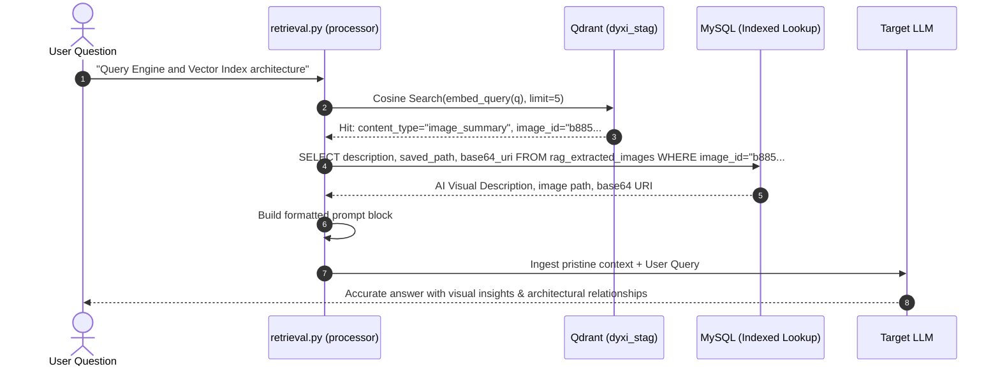

# Traceability & Queryable Relationship Guide: MySQL <-> Qdrant (`dyxi_stag`)

This document details the exact **traceable and queryable relationship** between the structured artifacts (tables, images, LaTeX formulas) stored in MySQL and the dense vector embeddings stored in Qdrant Vector Database collection **`dyxi_stag`**, including storage wiping, targeted subdirectory ingestion, and batch controls.

---

## 1. Architectural Summary: The Dual-Store Contract

In this enterprise RAG implementation:
- **Qdrant Vector Database** stores semantic summary embeddings ($768$-dimensional vectors) in collection **`dyxi_stag`**, optimized for high-recall Cosine similarity search across text passages, table schemas, formulas, and AI visual descriptions.
- **MySQL Database** stores pristine, intact source artifacts (raw Markdown tables, JSON row arrays, exact LaTeX math formulas, high-resolution visual assets, and AI image descriptions).



---

## 2. Storage Wiping & Targeted Re-Indexing (`--wipe`, `--sub-dir`, `--max-files`)

### 2.1 The `--wipe` Mechanism
When re-indexing a dataset or switching document collections:
- **MySQL Purge**: Executes `DELETE FROM` across `rag_extracted_tables`, `rag_extracted_formulas`, `rag_extracted_images`, and `rag_document_metadata`.
- **Qdrant Recreation**: Executes `delete_collection(dyxi_stag)` followed immediately by `create_collection(dyxi_stag, size=768, distance=Cosine)`.
- Ensures zero orphan points, zero dangling foreign keys, and zero duplicate vectors.

### 2.2 Subdirectory Targeting (`--sub-dir`)
Allows partitioning documents inside `DATA/`:
- `DATA/finetunes/` $\to$ processed via `--sub-dir finetunes`.
- `DATA/noisy/` $\to$ processed via `--sub-dir noisy`.
- The scanner restricts traversal strictly to `DATA/<sub_dir>`, ignoring other sibling folders.

### 2.3 Volume Ceiling (`--max-files`)
Limits execution to a fixed number of documents (e.g. `--max-files 10`). Useful for staged production rollouts, continuous integration smoke tests, and API token budgeting.

---

## 3. Shared Foreign Key & Identifier Contracts

Every entity possesses a deterministic identifier shared between MySQL and Qdrant (`dyxi_stag`):

| Entity Type | Shared Foreign Key | Formula | MySQL Table & Column | Qdrant Point Payload |
|---|---|---|---|---|
| **Document** | `document_id` | `uuid.uuid5(NAMESPACE_URL, file_path)` | `rag_document_metadata.document_id` (Unique Index) | `payload["document_id"]` |
| **Table** | `table_id` | `{document_id}#table_{index:03d}` | `rag_extracted_tables.table_id` (Unique Index) | `payload["table_id"]` |
| **LaTeX Formula** | `formula_id` | `{document_id}#formula_{index:03d}` | `rag_extracted_formulas.formula_id` (Unique Index) | `payload["formula_id"]` |
| **Image** | `image_id` | `{document_id}#image_{index:03d}` | `rag_extracted_images.image_id` (Unique Index) | `payload["image_id"]` |
| **Text Chunk** | `chunk_id` | `{file_name}#chunk_{index:05d}` | Referenceable via `file_name` & `page_no` | `payload["chunk_id"]` |

---

## 4. CLI & Programmatic Reference

### Setup & Ingestion CLI Commands
```bash
# 0. Initialize MySQL database (rag_metadata) and lookup tables
./scripts/setup_database.sh                         # Bash (Linux/macOS/Git Bash)
.\scripts\setup_database.ps1                       # PowerShell (Windows)

# 1. Full clean wipe and re-install of DATA/ into dyxi_stag
python -m app.ingestion.processor --wipe --collection dyxi_stag

# 2. Ingest only files inside DATA/finetunes
python -m app.ingestion.processor --sub-dir finetunes

# 3. Clean wipe and ingest at most 5 files from DATA/finetunes
python -m app.ingestion.processor --wipe --sub-dir finetunes --max-files 5
```

### Python API
```python
from app.ingestion.processor import ingest_directory, wipe_all_storage

# Wipe everything
wipe_all_storage(collection_name="dyxi_stag")

# Targeted ingestion with limits
summary = ingest_directory(
    directory_path="DATA",
    sub_dir="finetunes",
    max_files=5,
    wipe=False,
    collection_name="dyxi_stag"
)
```
